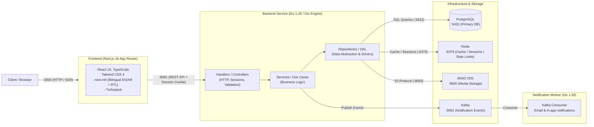

# PRIM

PRIM is a bilingual (English / Arabic) e-commerce platform. A Next.js storefront, account area, admin back office, and vendor portal sit on top of a Go REST API, backed by PostgreSQL for data, Redis for cache and sessions, Kafka for notifications, and MinIO for media.

It's meant to be the whole shop, not just a demo: a catalog with variants and inventory, a cart and checkout with coupons and Cash on Delivery, customer accounts with orders and addresses, an admin back office, and a media library. Some parts (the vendor portal, saved payment cards) are intentionally still in progress.

## What's in the box

**Storefront** — bilingual EN/AR with automatic RTL, catalog browsing and filters, product pages with variants and reviews, a slide-over cart, coupons, wishlist, and checkout with saved addresses. Shipping, tax, the COD fee, available payment methods, and the maintenance/announcement banners all come from the admin settings, so changing them changes the live storefront.

**Account area** (`/user`) — order history and details, addresses, reviews, wishlist, plus profile, preferences, session management, and a danger zone.

**Admin back office** (`/admin`) — dashboard, products and variants, categories, brands, tags, attributes, inventory with an adjustment ledger, orders and tracking, payments and refunds, promotions and redemptions, customers, media library, store settings, and system settings.

**Vendor portal** (`/vendor`) — dashboard, products, inventory, orders, and payouts. This is a frontend prototype backed by mock data; the backend vendor domain hasn't landed yet.

**Backend** — a Gin API organized into per-domain packages (handler → service → repository on a shared transaction runner), passwordless email-OTP auth with Redis sessions, Kafka-driven notifications handled by a separate worker, and MinIO uploads. Swagger docs are generated for both the public and admin surfaces.

## Architecture



## Tech stack

| Layer | Stack |
| --- | --- |
| Frontend | Next.js 16 (App Router), React 19, TypeScript 7, Tailwind CSS 4, next-intl, Sonner, Recharts |
| Backend | Go 1.26, Gin, pgx, Swag |
| Database | PostgreSQL 18 |
| Cache & sessions | Redis 8 |
| Messaging | Apache Kafka (KRaft) |
| Object storage | MinIO (S3-compatible) |
| Tooling | Docker Compose, Air (hot reload), golang-migrate, GitHub Actions, CodeQL |

## Getting started

You need Docker and Docker Compose. From the repository root:

```bash
make up       # start everything and follow the logs
make up-d     # or start it in the background
```

This brings up the storefront, API, worker, PostgreSQL, Redis, Kafka, and MinIO, seeds the media bucket, and runs the migrations. The first build takes a few minutes while Go modules and npm packages download.

Once it's up, open the storefront at <http://localhost:3000>. The API is at <http://localhost:8081>, and a quick health check lives at <http://localhost:8081/health>.

> **A note on the URL configuration.** `docker-compose.dev.yml` points the frontend and MinIO at a LAN address (`192.168.1.16`) so the stack is reachable from other devices on the network. If you only ever use your own machine, change `NEXT_PUBLIC_API_URL`, `API_URL`, `MINIO_PUBLIC_URL`, and `CLIENT_BASE_URL` in that file to `localhost`.

### Services and ports

| Service | Address | Notes |
| --- | --- | --- |
| Storefront | <http://localhost:3000> | Next.js app |
| API | <http://localhost:8081> | Go REST API |
| Health check | <http://localhost:8081/health> | Liveness |
| Public API docs | <http://localhost:8081/api/v1/docs/public/index.html> | Swagger UI |
| Admin API docs | <http://localhost:8081/api/v1/docs/admin/index.html> | Requires an admin session |
| MinIO API | <http://localhost:9000> | S3 endpoint |
| MinIO console | <http://localhost:9001> | `admin` / `supersecret` |
| PostgreSQL | `localhost:5432` | db `prim`, user `prim`, password `prim` |
| Redis | `localhost:6379` | |
| Kafka | `localhost:9092` | |

## Common commands

Everything day-to-day is wrapped by the root `Makefile`:

```bash
make up            # start the full stack in the foreground
make up-d          # start it detached
make up-build      # rebuild images, then start
make down          # stop the containers
make clean         # stop and remove volumes (fresh database)

make logs          # tail everything
make logs-api      # only the Go API
make logs-worker   # only the notification worker
make logs-frontend # only the Next.js app

make migrate-up    # apply pending migrations
make migrate-down  # roll back the last migration
make migrate-reset # drop and re-apply everything
```

More backend-specific targets (Swagger generation, binary builds, linting) live in `backend/Makefile`.

## Repository layout

```
prim/
├── backend/                     # Go API + notification worker
│   ├── cmd/                     # entrypoints: api, worker
│   ├── internal/                # domain packages (auth, catalog, cart, checkout, order, user, setting, ...)
│   ├── migrations/              # SQL schema + seed data
│   ├── pkg/                     # shared config, database, storage, logging, mail, broker
│   ├── configs/                 # config.yaml and Air hot-reload configs
│   ├── docs/                    # generated Swagger specs (public + admin)
│   └── seed/                    # seed media for the catalog
├── frontend/                    # Next.js 16 storefront, account, admin, and vendor apps
│   ├── messages/                # en.json / ar.json
│   ├── public/                  # static assets
│   └── src/                     # app routes, features, context, services, hooks
├── docker-compose.dev.yml       # the local development stack
├── Makefile                     # development shortcuts
└── README.md
```

## Where things stand

- The **vendor portal** is frontend-only for now: its pages read from mock data until the vendor backend and API land.
- **Saved payment methods** are a UI shell; cards aren't persisted yet, and checkout currently runs Cash on Delivery (plus any card option enabled in settings).
- Admin settings are wired through to real behavior — checkout pricing, the maintenance gate, payment availability, and the storefront's identity and announcement banner all read from the backend settings store.

## License

MIT
