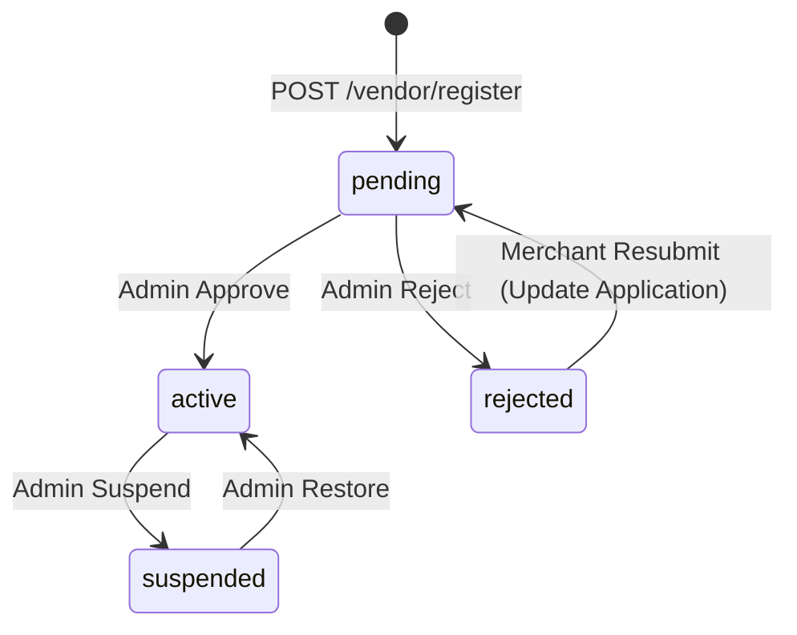

# Merchant Architecture: Gateway, Onboarding & Lifecycle Specification

## 1. Executive Summary & Core Architectural Paradigm

In a multi-vendor marketplace, merchants (vendors) require dedicated access patterns, operational isolation, and lifecycle governance separate from retail customers.

### The Entitlement Model vs. Role Hierarchy
A common anti-pattern is treating "vendor" as a global user role (`users.role = 'vendor'`). In PRIM:
- **`users.role` is strictly a staff privilege tier**: `customer`, `admin`, `superadmin`. Retail customers and prospective merchants share `role: customer`. Admin and superadmin roles gate staff surfaces (`/admin/*`).
- **Merchant capability is an entitlement governed by resource ownership**: An authenticated user becomes a merchant by owning a profile row in the `vendors` table (`vendors.user_id = auth.user_id`).
- **Operational access is governed by lifecycle status**: Access to products, inventory, orders, and payouts is controlled by `vendors.status` (`pending`, `active`, `suspended`, `rejected`), not by mutating user session roles.

This decoupled entitlement architecture brings major operational advantages:
1. **Zero Session Invalidation on Onboarding**: Existing customer sessions remain fully valid upon store registration; no Redis session cache rewrites or forced re-authentications are required.
2. **Clean Lifecycle Transitions**: A suspended or rejected merchant retains their user identity and can access dedicated compliance or re-application status views without breaking authentication.
3. **No Role Bloat**: The platform avoids role explosions (e.g. `vendor_pending`, `vendor_suspended`, `vendor_admin`).

---

## 2. High-Level Architecture & Route Decomposition

```
                           ┌───────────────────────────────────────────────┐
                           │          (marketing)/sell Landing Page         │
                           │   - B2B value proposition & commercial terms  │
                           │   - Standard 10% commission & payout terms    │
                           │   - Decoupled from consumer catalog facets    │
                           └───────────────────────┬───────────────────────┘
                                                   │
                                 Canonical CTA URL │ /vendor
                                                   ▼
                           ┌───────────────────────────────────────────────┐
                           │             /vendor Resolver Page             │
                           │      Inspects Session & Vendor Entitlement    │
                           └───────────────────────┬───────────────────────┘
                                                   │
         ┌───────────────────┬─────────────────────┼─────────────────────┬───────────────────┐
         ▼                   ▼                     ▼                     ▼                   ▼
   Unauthenticated    Unregistered          Status: `pending`     Status: `suspended`  Status: `rejected`
   ┌─────────────┐   ┌────────────────┐    ┌───────────────┐     ┌───────────────┐    ┌───────────────┐
   │ Redirect to │   │ Redirect to    │    │ Redirect to   │     │ Redirect to   │    │ Redirect to   │
   │ /auth?      │   │ /vendor/       │    │ /vendor/      │     │ /vendor/      │    │ /vendor/      │
   │ redirect=   │   │ register       │    │ pending       │     │ suspended     │    │ rejected      │
   │ /vendor     │   │ (Store Wizard) │    │ (Under Review)│     │ (Policy Hold) │    │ (Re-apply)    │
   └─────────────┘   └────────────────┘    └───────────────┘     └───────────────┘    └───────────────┘
                                                                                             │
                                                                           Status: `active`  │
                                                                           ┌─────────────────┴─┐
                                                                           ▼                   ▼
                                                                ┌───────────────────────────────────┐
                                                                │   /vendor/(console) Route Group   │
                                                                │      Active Merchant Console      │
                                                                ├───────────────────────────────────┤
                                                                │  - /vendor/dashboard              │
                                                                │  - /vendor/products               │
                                                                │  - /vendor/inventory              │
                                                                │  - /vendor/orders                 │
                                                                │  - /vendor/payouts                │
                                                                └───────────────────────────────────┘
```

---

## 3. Surface & Authorization Boundary Split

The backend authorization boundaries are partitioned into distinct surfaces based on authentication and resource entitlement:

| Surface / Route | Authentication Required | Authorization Gate | Behavior & Error Codes |
| :--- | :---: | :--- | :--- |
| `(marketing)/sell` | None (Public) | None | Public B2B landing page; zero catalog facet overhead. |
| `POST /api/v1/vendor/register` | Authenticated (`RequireAuth`) | None | Any authenticated session may apply. DB unique constraint enforces 1 store per account. |
| `GET /api/v1/vendor/slug-availability` | Authenticated (`RequireAuth`) | None | Validates slug syntax, checks reserved word set, and performs live DB uniqueness lookup. |
| `GET /api/v1/vendor/profile` | Authenticated (`RequireAuth`) | Profile Ownership | Returns 200 with profile DTO if exists; returns 404 with code `VENDOR_NOT_FOUND` if unregistered. |
| `PATCH /api/v1/vendor/profile` | Authenticated (`RequireAuth`) | Profile Ownership + Lifecycle | Permitted for `pending`, `active`, and `rejected` (re-application). Blocked for `suspended` (403 `VENDOR_NOT_AUTHORIZED_FOR_ACTION`). Slug is immutable once `active`. |
| `GET /api/v1/vendor/dashboard` | Authenticated (`RequireAuth`) | `requireActiveVendor` | Returns 403 `VENDOR_NOT_AUTHORIZED_FOR_ACTION` if vendor is not `active`. |
| `POST /api/v1/vendor/products` | Authenticated (`RequireAuth`) | `requireActiveVendor` | Returns 403 `VENDOR_NOT_AUTHORIZED_FOR_ACTION` if vendor is not `active`. |
| `GET /api/v1/vendor/products` | Authenticated (`RequireAuth`) | `requireActiveVendor` | Scoped to caller's `vendor_id`. Blocked for non-active states. |
| `POST /api/v1/vendor/payouts` | Authenticated (`RequireAuth`) | `requireActiveVendor` | Enforces row lock and balance checks; blocked if not `active`. |
| `GET /api/v1/vendor/payouts` | Authenticated (`RequireAuth`) | Profile Ownership | Active and suspended vendors may review payout history. |
| `GET /api/v1/vendor/orders` | Authenticated (`RequireAuth`) | Profile Ownership | Read-only slice containing lines owned by caller's store. |
| `/api/v1/admin/vendors/*` | Authenticated (`RequireAuth`) | Staff Tier (`admin`, `superadmin`) | Administrative review, status transitions, commission overrides, and payout moderation. |

---

## 4. Visitor-to-Merchant Transition & Marketing Decoupling

### 1. `/sell` Route Group Placement
- **Location**: `frontend/src/app/[locale]/(marketing)/sell/page.tsx`
- **Isolation**: Mounted inside a lightweight `(marketing)` route group with minimal header/footer. It does **not** mount `CatalogProvider` or fetch customer shopping facets, avoiding consumer cart/catalog coupling.
- **Rendering**: Server-rendered with static metadata, optimized for SEO, fast LCP, and bilingual (English/Arabic) internationalization.

### 2. Canonical CTA Flow
All merchant acquisition CTAs on the storefront, marketing pages, or footer navigate to a single canonical entry point:
```
/sell  ──(CTA: "Start Selling / ابدأ البيع")──►  /vendor
```
The central resolver at `/vendor` evaluates session state and redirects to the appropriate state segment:
- Unauthenticated visitor ➔ `/auth?redirect=/vendor`
- Customer without store profile ➔ `/vendor/register`
- Vendor in review ➔ `/vendor/pending`
- Vendor on hold ➔ `/vendor/suspended`
- Vendor rejected ➔ `/vendor/rejected`
- Active vendor ➔ `/vendor/dashboard`

---

## 5. Route-Segment State Architecture (Frontend)

To prevent URL/state mismatches, deep linking ambiguity, and browser history corruption, the vendor workspace is structured as route segments rather than a monolithic layout branch:

```
frontend/src/app/[locale]/(vendor)/vendor/
├── layout.tsx                 <-- Root context wrapper: mounts VendorProvider and auth listener
├── page.tsx                   <-- Central resolver: redirects to canonical route segment
├── register/page.tsx          <-- Store registration onboarding wizard
├── pending/page.tsx           <-- Under review status shell
├── suspended/page.tsx         <-- Compliance hold status shell with support instructions
├── rejected/page.tsx          <-- Application declined view with re-application action
└── (console)/                 <-- Route group: active merchants only
    ├── layout.tsx             <-- Operational console layout (header + sidebar navigation)
    ├── dashboard/page.tsx     <-- Metrics, charts, revenue position
    ├── products/page.tsx      <-- Product catalog management
    ├── inventory/page.tsx     <-- Variant stock level adjustments
    ├── orders/page.tsx        <-- Vendor order fulfillment tracking
    └── payouts/page.tsx       <-- Payout ledger & withdrawal requests
```

### State Model Discrimination
The frontend derives a single discriminated union state:
```typescript
export type VendorState =
  | "loading"
  | "unauthenticated"
  | "unregistered"
  | "pending"
  | "active"
  | "suspended"
  | "rejected"
  | "error";
```

### Non-Active States: Shared `VendorStatusShell`
Non-active pages (`pending`, `suspended`, `rejected`) do not render the operational console sidebar or header. Instead, they mount a shared `VendorStatusShell` containing:
1. Store identity header (Store name, slug, application ID).
2. Status explanation badge and contextual alert box.
3. Relevant action (e.g. "Update Application & Re-apply" for rejected; "Contact Compliance Support" for suspended).
4. Direct links to storefront and safe sign-out.

---

## 6. Store Slug Policy, Reserved Words & Availability

### Validation Rules
| Parameter | Rule | Details |
| :--- | :--- | :--- |
| **Length** | 3 to 63 characters | Enforced both in client validation and backend service. |
| **Charset** | `^[a-z0-9]+(?:-[a-z0-9]+)*$` | Lowercase ASCII letters, numbers, and single internal hyphens. No leading, trailing, or consecutive hyphens (`--`). |
| **Normalization**| NFKC + Trim + Lowercase | Automatically sanitized; unexpected whitespace or uppercase characters are normalized. |
| **Reserved Slugs**| 28 Platform Keywords | `admin`, `api`, `auth`, `vendor`, `sell`, `store`, `stores`, `products`, `categories`, `brands`, `cart`, `checkout`, `account`, `user`, `orders`, `payments`, `settings`, `support`, `help`, `about`, `terms`, `privacy`, `login`, `register`, `search`, `wishlist`, `en`, `ar`. |
| **Immutability** | Fixed Once Approved | Slugs may be modified during `pending` or `rejected` re-application, but become permanently immutable once transitioned to `active`. |

### Availability Endpoint
`GET /api/v1/vendor/slug-availability?slug={candidate}`
- **Authentication**: Authenticated user (`RequireAuth`).
- **Response Format**:
```json
{
  "data": {
    "available": false,
    "slug": "admin",
    "reason": "This slug is a reserved platform keyword"
  }
}
```
- **Error Mapping on Registration Conflict**:
  If a race condition occurs on submission against the database unique constraint (`vendors_slug_key`), the backend catches the error and returns HTTP 409 Conflict with code `VENDOR_SLUG_TAKEN` and a structured field error:
  ```json
  {
    "code": "VENDOR_SLUG_TAKEN",
    "message": "This store slug is already taken",
    "details": [
      {
        "field": "slug",
        "constraint": "unique",
        "message": "this store slug is already taken"
      }
    ]
  }
  ```

---

## 7. Lifecycle State Machine & Re-application

### Allowed Status Transitions



### State Transition Rules
1. **`pending` ➔ `active`**: Admin approval clears the merchant to sell. Products become eligible for public storefront listing.
2. **`pending` ➔ `rejected`**: Admin rejects the application. A merchant-facing `status_reason` is recorded.
3. **`rejected` ➔ `pending`**: A rejected merchant can modify their application (`store_name`, `slug`, `description`) via `PATCH /vendor/profile` or re-submission. The transition clears the prior rejection state and re-enters the admin review queue.
4. **`active` ➔ `suspended`**: Immediate compliance freeze. Store products are suppressed from search and catalog, and payouts are frozen.
5. **`suspended` ➔ `active`**: Compliance hold lifted; store operations resume.

### Audit & Reviewer Metadata
Status transitions record:
- `reviewed_by`: UUID of the administrator performing the action.
- `reviewed_at`: UTC timestamp of the review decision.
- `status_reason`: Merchant-visible explanation for rejection or suspension.

---

## 8. Server-Side Status Enforcement & Payout Safety

The frontend state machine is strictly a user-experience routing layer. The backend service layer enforces the status matrix on every operation:

### Status-to-Operation Matrix
| Operation | `pending` | `active` | `suspended` | `rejected` |
| :--- | :---: | :---: | :---: | :---: |
| Read/Update Application Profile | ✅ | ✅ | ❌ | ✅ (Re-apply) |
| View Operational Dashboard | ❌ (403) | ✅ | ❌ (403) | ❌ (403) |
| List/Create/Publish Products | ❌ (403) | ✅ | ❌ (403) | ❌ (403) |
| Stock Movements & Adjustments | ❌ (403) | ✅ | ❌ (403) | ❌ (403) |
| View Order History | ❌ (403) | ✅ | ✅ (Read-Only) | ❌ (403) |
| Request New Payout | ❌ (403) | ✅ | ❌ (403) | ❌ (403) |
| Admin Process/Pay Payout | ❌ (409) | ✅ | ❌ (409 Held) | ❌ (409 Held) |

### Payout Settlement Constraints (v1 Reality)
1. **Payout Holds During Suspension**: `AdminTransitionPayout` checks vendor status before transitioning any payout to `approved`, `processing`, or `paid`. If the vendor is suspended or rejected, the transition is rejected with HTTP 409 Conflict (`VENDOR_NOT_AUTHORIZED_FOR_ACTION`).
2. **Settlement on Delivered Orders**: Earnings become payout-eligible only after orders reach terminal `delivered` status. In multi-vendor carts, v1 settles upon whole-order delivery.
3. **Derivation Invariant & Concurrency**: Payout balance validation executes under an explicit `SELECT ... FOR UPDATE` lock on the vendor row (`GetByIDForUpdate`) to prevent concurrent double-withdrawal race conditions.
4. **Commercial Terms Configuration**: Standard platform commission is 10% (`1000 bps`), configurable per-vendor via administrative override (`AdminSetCommissionRate`).

---

## 9. Security & Frontend Robustness

### 1. Open Redirect Prevention in Auth Flows
In `frontend/src/modules/auth/components/VerifyView.tsx`, all `?redirect=` parameters are validated before client-side router navigation:
- Must begin with a single `/`.
- Rejects protocol-relative paths starting with `//` or `/\\`.
- Rejects absolute URLs containing `:`, `http:`, or `https:`.
- Falls back safely to `/` if invalid.

### 2. Reliable Error Detection in Vendor Context
In `frontend/src/modules/vendor/routes/vendorContext.tsx`, profile absence is detected via HTTP status (`404`) and machine-readable API error code (`VENDOR_NOT_FOUND`) rather than brittle localized string regex matching.

### 3. Real-Time State Synchronization
To handle cases where an admin suspends or approves a vendor while the vendor portal is open in another tab:
- Vendor profile is re-fetched automatically on browser `visibilitychange` (tab focus).
- All operational mutations handle `VENDOR_NOT_AUTHORIZED_FOR_ACTION` by triggering `refreshVendor()` to transition immediately to the correct state screen.

---

## 10. API Specification Reference

All endpoints conform to RFC 9205 and use `PATCH` for partial resource updates:

### Portal Endpoints
```http
POST   /api/v1/vendor/register           # Register new vendor application
GET    /api/v1/vendor/slug-availability  # Real-time slug availability check
GET    /api/v1/vendor/profile            # Read current merchant profile
PATCH  /api/v1/vendor/profile            # Update merchant profile / re-apply
GET    /api/v1/vendor/dashboard          # Operational metrics (active only)
GET    /api/v1/vendor/products           # Merchant product listing (active only)
POST   /api/v1/vendor/products           # Create draft product (active only)
PATCH  /api/v1/vendor/products/:id       # Update product (active only)
DELETE /api/v1/vendor/products/:id       # Soft delete product (active only)
POST   /api/v1/vendor/products/:id/publish # Publish product (active only)
POST   /api/v1/vendor/products/:id/archive # Archive product (active only)
GET    /api/v1/vendor/products/:id/variants # List variants (active only)
POST   /api/v1/vendor/products/:id/variants # Create variant (active only)
PATCH  /api/v1/vendor/variants/:id       # Update variant (active only)
DELETE /api/v1/vendor/variants/:id       # Delete variant (active only)
POST   /api/v1/vendor/variants/:id/stock # Adjust stock delta (active only)
GET    /api/v1/vendor/orders             # Vendor order slice (active/suspended)
GET    /api/v1/vendor/orders/:id         # Vendor order details (active/suspended)
GET    /api/v1/vendor/payouts            # Payout history (active/suspended)
POST   /api/v1/vendor/payouts            # Request payout withdrawal (active only)
```

### Admin Endpoints
```http
GET    /api/v1/admin/vendors             # List all vendor applications/profiles
GET    /api/v1/admin/vendors/:id         # Get vendor profile details
PATCH  /api/v1/admin/vendors/:id/status  # Transition status (active, suspended, rejected)
PATCH  /api/v1/admin/vendors/:id/commission # Override commission rate (bps)
GET    /api/v1/admin/vendors/payouts     # List pending and historical payouts
PATCH  /api/v1/admin/vendors/payouts/:id/transition # Approve, process, pay, or reject payout
```
