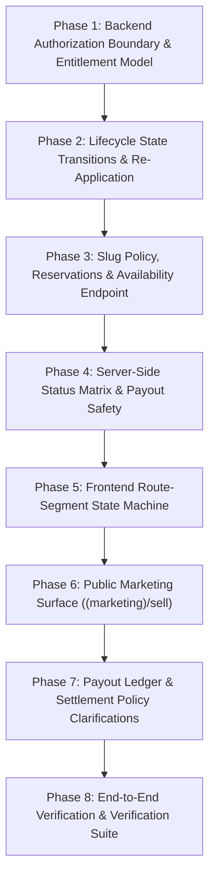

# Merchant Gateway, Onboarding & Lifecycle: Implementation Plan

## 1. Goal & Architectural Objectives

Transform the PRIM merchant access surface into a dedicated, enterprise-grade B2B gateway, onboarding funnel, and lifecycle control system matching the engineering caliber of Shopify and Amazon Seller Central.

### Architectural Commitments:
1. **Entitlement Model**: Treat `users.role` as a staff tier only (`admin`/`superadmin`). Vendor capabilities are governed strictly by resource ownership in the `vendors` table and `vendors.status`.
2. **Clean Route-Segment State Machine**: Replace layout-based conditional branching with explicit Next.js route segments (`/vendor`, `/vendor/register`, `/vendor/pending`, `/vendor/suspended`, `/vendor/rejected`, `/vendor/(console)/*`).
3. **Decoupled Marketing Surface**: Create a dedicated `(marketing)/sell` route group isolated from consumer shopping chrome and catalog facet queries.
4. **Re-Application Loop**: Support `rejected ➔ pending` transitions on resubmission, clearing rejection flags and allowing store data edits.
5. **Server-Side Status Matrix & Payout Safety**: Enforce status gates on every operation (e.g. payout hold during suspension) rather than relying on frontend guards.
6. **Robust Input Validation & Security**: Implement strict slug validation (3–63 chars, reserved words, availability endpoint), eliminate open redirects, and replace message-based error matching with typed API error codes.

---

## 2. Recommended Build Order & Phase Breakdown



---

## 3. Detailed Phase Breakdown

### Phase 1: Backend Authorization Boundary & Entitlement Model
- [ ] **Task 1.1: Decouple `/vendor` Route Group from Staff Roles**
  - **File**: `backend/internal/vendors/vendor_router.go`
  - **Issue**: The entire `/vendor` group currently applies `Authorize(model.VendorRole, model.AdminRole, model.SuperRole)`. Authenticated `customer` users receive HTTP 403 on `POST /vendor/register` before the handler executes.
  - **Action**: 
    - Remove `middleware.Authorize(...)` from the base `/vendor` group.
    - Apply `middleware.Authenticate(r.sessionStore)` only.
    - Keep `middleware.Authorize(model.AdminRole, model.SuperRole)` strictly on `/admin/vendors/*`.
- [ ] **Task 1.2: Establish Profile Discovery Semantics**
  - **Endpoint**: `GET /api/v1/vendor/profile`
  - When an authenticated customer without a store queries this endpoint, return HTTP 404 with standard error code `errcode.CodeVendorNotFound` (`VENDOR_NOT_FOUND`).
- [ ] **Task 1.3: Add Contract Integration Tests**
  - **File**: `backend/internal/vendors/vendor_test.go`
  - Add test: `TestCustomerCanRegisterAndReadProfile`:
    - Create session with `role: customer`.
    - Submit `POST /api/v1/vendor/register` ➔ verify HTTP 201 Created.
    - Call `GET /api/v1/vendor/profile` ➔ verify HTTP 200 with `status: pending`.
    - Verify `users.role` remains `customer` (no unexpected role mutation).

---

### Phase 2: Lifecycle State Transitions & Re-Application
- [ ] **Task 2.1: Extend Vendor Lifecycle State Machine**
  - **File**: `backend/internal/vendors/vendor_service.go`
  - Update `isValidVendorTransition` to permit `rejected ➔ pending`.
- [ ] **Task 2.2: Implement Resubmission Logic in Service**
  - In `RegisterVendor`: If caller already has a vendor row and its status is `rejected`, treat the submission as a re-application:
    - Update store name, slug, description, and asset references.
    - Transition status from `rejected` back to `pending`.
    - Reset `rejection_reason` / `status_reason`.
  - In `UpdateMyProfile`: Allow `rejected` vendors to edit their application data and trigger status transition to `pending`.
- [ ] **Task 2.3: Admin Rejection Metadata**
  - Add `status_reason` parameter to `AdminChangeVendorStatus` so administrators can provide a merchant-facing explanation when rejecting or suspending an application.
- [ ] **Task 2.4: Integration Tests for Re-Application**
  - Verify that a `rejected` vendor profile can update details, successfully transition back to `pending`, and reappear in the admin moderation queue.

---

### Phase 3: Slug Policy, Reservations & Availability Endpoint
- [ ] **Task 3.1: Define Canonical Slug Policy**
  - **Length**: 3 to 63 characters.
  - **Charset**: `^[a-z0-9]+(?:-[a-z0-9]+)*$` (lowercase alphanumeric with single internal hyphens).
  - **Normalization**: NFKC + trim + lowercase.
  - **Reserved Words**: `admin`, `api`, `auth`, `vendor`, `sell`, `store`, `stores`, `products`, `categories`, `brands`, `cart`, `checkout`, `account`, `user`, `orders`, `payments`, `settings`, `support`, `help`, `about`, `terms`, `privacy`, `login`, `register`, `search`, `wishlist`, `en`, `ar`.
- [ ] **Task 3.2: Implement Slug Availability Endpoint**
  - **Endpoint**: `GET /api/v1/vendor/slug-availability?slug={candidate}`
  - **Handler**: `Handler.CheckSlugAvailability` in `vendor_handler.go`.
  - **Service**: `Service.CheckSlugAvailability` in `vendor_service.go`.
  - **Repository**: Add `SlugExists(ctx, slug)` in `vendor_repository.go` (checks `vendors` table including soft-deleted records).
  - Returns `{ available: boolean, slug: string, reason?: string }`.
- [ ] **Task 3.3: Field-Level Conflict Mapping**
  - When `POST /vendor/register` hits a unique constraint violation on `slug`, map the database conflict to HTTP 409 with error code `VENDOR_SLUG_TAKEN` and field error `{ field: "slug", constraint: "unique", message: "this store slug is already taken" }`.
- [ ] **Task 3.4: Enforce Slug Immutability**
  - Once a vendor status reaches `active`, reject changes to `slug` in `PATCH /vendor/profile` with HTTP 400 Bad Request.

---

### Phase 4: Server-Side Status Matrix & Payout Safety
- [ ] **Task 4.1: Operational Endpoint Status Guards**
  - Ensure all operational endpoints invoke `requireActiveVendor(ctx, userID)`:
    - `GET /vendor/dashboard` ➔ Enforce active status.
    - `POST /vendor/products`, `PATCH /vendor/products/:id`, `DELETE /vendor/products/:id` ➔ Enforce active status.
    - `POST /vendor/variants/:id/stock` ➔ Enforce active status.
    - `POST /vendor/payouts` ➔ Enforce active status.
- [ ] **Task 4.2: Enforce Payout Holds for Suspended Vendors**
  - **File**: `AdminTransitionPayout` in `vendor_service.go`.
  - When transitioning a payout to `approved`, `processing`, or `paid`, inspect the vendor's current status.
  - If vendor is `suspended` or `rejected`, abort with HTTP 409 Conflict (`VENDOR_NOT_AUTHORIZED_FOR_ACTION`) and message `"Payouts cannot be processed while vendor is not active"`.
- [ ] **Task 4.3: Read-Only History for Suspended Vendors**
  - Allow suspended vendors to access `GET /vendor/orders` and `GET /vendor/payouts` so they can view historical records while barred from new sales or withdrawals.

---

### Phase 5: Frontend Route-Segment State Machine
- [ ] **Task 5.1: Structure Route Segments in Next.js App Router**
  - Directory: `frontend/src/app/[locale]/(vendor)/vendor`
  - Reorganize files into dedicated route segments:
    ```
    vendor/
    ├── layout.tsx                 (VendorRootLayout: auth context & VendorProvider)
    ├── page.tsx                   (Resolver page: directs to appropriate segment)
    ├── register/page.tsx          (Store registration onboarding wizard)
    ├── pending/page.tsx           (Under review status shell)
    ├── suspended/page.tsx         (Compliance hold status shell)
    ├── rejected/page.tsx          (Application declined shell with re-apply action)
    └── (console)/                 (Active merchants only)
        ├── layout.tsx             (Console layout: header + sidebar navigation)
        ├── dashboard/page.tsx
        ├── products/page.tsx
        ├── inventory/page.tsx
        ├── orders/page.tsx
        └── payouts/page.tsx
    ```
- [ ] **Task 5.2: Central State Resolver (`/vendor/page.tsx`)**
  - Read `vendorContext` (`loading`, `vendor`, `notRegistered`).
  - Derive `vendorState`:
    - `unauthenticated` ➔ Redirect to `/auth?redirect=/vendor`.
    - `unregistered` (404 `VENDOR_NOT_FOUND`) ➔ Redirect to `/vendor/register`.
    - `pending` ➔ Redirect to `/vendor/pending`.
    - `suspended` ➔ Redirect to `/vendor/suspended`.
    - `rejected` ➔ Redirect to `/vendor/rejected`.
    - `active` ➔ Redirect to `/vendor/dashboard`.
- [ ] **Task 5.3: Build Shared `VendorStatusShell`**
  - Create reusable status layout for non-active states containing store identity, status explanation, action buttons, support contact, and sign-out.
- [ ] **Task 5.4: Console Guard in `(console)/layout.tsx`**
  - If a user directly accesses `/vendor/dashboard` or `/vendor/products` while not `active`, redirect immediately to `/vendor` so the resolver can place them in the correct status segment.
- [ ] **Task 5.5: Fix Open Redirect in `VerifyView.tsx`**
  - File: `frontend/src/modules/auth/components/VerifyView.tsx`
  - Sanitize `?redirect=` parameter: allow only internal paths starting with a single `/`; reject `//`, `/\\`, `http:`, and `https:`.
- [ ] **Task 5.6: Fix Error-Detection Heuristic in `vendorContext.tsx`**
  - Replace regex `/vendor not found|HTTP Error 404/i` with typed checking of HTTP status `404` and API error code `VENDOR_NOT_FOUND`.
  - Add `visibilitychange` listener to re-fetch profile when user returns to tab.

---

### Phase 6: Public Marketing Surface (`(marketing)/sell`)
- [ ] **Task 6.1: Create Marketing Route Group**
  - Create `frontend/src/app/[locale]/(marketing)/layout.tsx`:
    - Minimal header with logo and "Sign In / Storefront" links.
    - Minimal footer with legal and merchant support links.
    - Zero `CatalogProvider` or shopping cart facets.
- [ ] **Task 6.2: Implement `/sell` Acquisition Page**
  - Location: `frontend/src/app/[locale]/(marketing)/sell/page.tsx`.
  - Sections:
    - **Hero Section**: Clear value proposition ("Sell on PRIM / ابنِ متجرك على بريم") with primary CTA pointing to canonical `/vendor`.
    - **Commercial Transparency**: Standard 10% commission (`1000 bps`), zero upfront listing fees, custom enterprise terms available.
    - **Settlement Terms**: Direct bank transfer upon order delivery.
    - **Onboarding Steps**: 3-step visual guide (1. Apply ➔ 2. Fast Admin Review ➔ 3. List & Earn).
    - **Merchant FAQ**: Realistic answers on delivery requirements, settlement timing, and support.
- [ ] **Task 6.3: Storefront Navigation Links**
  - Add "Sell on PRIM / ابدأ البيع" link to storefront main header and footer navigation pointing to `/sell`.

---

### Phase 7: Payout Ledger & Settlement Policy Clarifications
- [ ] **Task 7.1: Settlement Rule Clarification in Documentation**
  - Document that v1 settlements occur upon terminal whole-order `delivered` status.
  - Document that payout requests are manual, subject to administrator approval and bank transfer execution.
- [ ] **Task 7.2: Payout Idempotency Preparation**
  - Prepare migration/specification for `idempotency_key` on `vendor_payouts` to guarantee retry safety during network disruptions.
- [ ] **Task 7.3: Order Line Item Commission Record**
  - Specify stamping of `commission_rate_bps` and `commission_amount` on `order_items` at checkout to ensure tamper-proof historical audits.

---

### Phase 8: End-to-End Verification & Verification Suite
- [ ] **Task 8.1: Unit & Contract Tests**
  - Run `cd backend && go test ./internal/vendors/...` covering:
    - Customer registration without staff role.
    - Slug availability validation and reserved-word rejection.
    - `rejected ➔ pending` re-application transition.
    - Payout hold on suspended vendor during admin transition.
- [ ] **Task 8.2: Frontend TypeScript & Lint Verification**
  - Run `cd frontend && npx tsc --noEmit` to ensure type-safety across all route segments.
- [ ] **Task 8.3: Full Stack Smoke Test**
  - Start stack (`make prod-up`).
  - Register a new customer ➔ visit `/sell` ➔ register store ➔ verify `/vendor/pending`.
  - Log in as admin ➔ reject application ➔ verify merchant sees `/vendor/rejected`.
  - Merchant resubmits application ➔ verify status returns to `pending`.
  - Admin approves application ➔ verify merchant is redirected to active `/vendor/dashboard`.
  - Admin suspends store ➔ verify merchant is redirected to `/vendor/suspended` and products are unlisted.

---

## 4. Risks & Mitigations

| Risk | Impact | Mitigation Strategy |
| :--- | :---: | :--- |
| **Breaking Existing Vendor Links** | High | Using route group `(console)` keeps all existing URLs (`/vendor/dashboard`, `/vendor/products`, etc.) identical. |
| **Open Redirect Vulnerabilities** | High | Strict path sanitization on all `?redirect=` parameters in authentication views. |
| **Concurrent Slug Collision** | Medium | DB unique constraint on `vendors.slug` remains the ultimate authority; conflicts map to field-level `VENDOR_SLUG_TAKEN`. |
| **Payout Double-Spending** | High | Row-level locking (`SELECT ... FOR UPDATE`) in `RequestPayout` serializes balance validation. |
